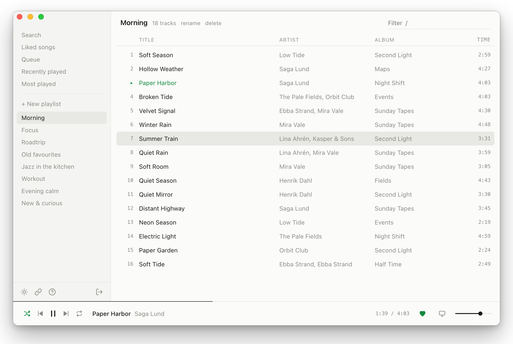

# slim

A minimal, text-only Spotify player for macOS and Linux. No album art, no feeds, no clutter: your playlists, your liked songs, a queue, and keyboard shortcuts.

<p align="center">
  <picture>
    <source media="(prefers-color-scheme: dark)" srcset="docs/screenshot-dark.png">
    
  </picture>
</p>

Plain HTML/CSS/JS frontend in `slim/`. macOS is a Tauri 2 app (`src-tauri/`). Linux is an Electron app (`src-electron/`) with Widevine; if that window cannot play Spotify it opens system Chrome or Chromium instead. Playback uses the Spotify Web Playback SDK.

## Install

### macOS

Download the latest `.dmg` from [Releases](https://github.com/oovets/slim/releases), open it and drag **slim** to Applications. Apple Silicon (M1 or newer), macOS 11+.

The app is not signed with an Apple Developer ID, so macOS blocks it the first time. Either open **System Settings → Privacy & Security** and click **Open Anyway** after trying to launch it, or run once:

```bash
xattr -dr com.apple.quarantine /Applications/slim.app
```

### Linux

Download the latest `.AppImage` from [Releases](https://github.com/oovets/slim/releases), mark it executable, and run it. It is unsigned.

Local playback needs Widevine. slim opens its own window first. If that webview has no DRM, it opens Google Chrome or Chromium in app mode on the same local page, so one of `google-chrome-stable`, `google-chrome`, `chromium`, or `chromium-browser` must be installed. Controlling another Spotify Connect device works either way.

## Set up Spotify (once)

Spotify requires every app to use a developer Client ID, so you create your own (free, takes a minute). You also need **Spotify Premium**; the Web Playback SDK does not work on free accounts.

1. Go to [developer.spotify.com/dashboard](https://developer.spotify.com/dashboard) and create an app.
2. Add this redirect URI, exactly: `http://127.0.0.1:5173/` (`localhost` is rejected).
3. Under "APIs used", tick **Web Playback SDK** (and Web API).
4. Open slim, paste the app's **Client ID** and click **Connect**.

Spotify limits apps in development mode to 5 users and requires the app owner to have Premium, which is plenty for personal use.

## Shortcuts

Press `?` in the app for the list.

| Key | Action |
|---|---|
| space | play / pause |
| ↑ ↓ or j k | select track |
| enter | play selected |
| ← → | seek 10 s |
| n / p | next / previous |
| s / r | shuffle / repeat |
| q | add to queue |
| a | add to playlist |
| d | play on another device |
| ⌫ ⌫ | remove from playlist |
| ⌥ ↑ / ⌥ ↓ | move track in playlist |
| + / − | volume |
| / | filter (search view: search) |
| l | like |
| t | theme (auto / light / dark) |
| b | hide / show the sidebar (also the button next to the title) |
| ⌘ + / ⌘ − / ⌘ 0 | zoom (ctrl on Linux) |

## What it can and cannot do

Spotify's API only lets apps created recently read the tracks of playlists you own or collaborate on. Other playlists can still be played, but by default their track list can't be shown (see the optional fallback below). Recommendations, audio analysis, lyrics and offline downloads are not available to third-party apps.

## Resource use

How slim compares with the official Spotify desktop app, measured on macOS 26 on an Apple M4 Max on AC power, with the window visible. CPU is a percentage of one core. Memory is the physical footprint (what Activity Monitor shows as "Memory") summed over all of the app's processes: slim is the app plus three WebKit helper processes, Spotify is eight processes.

| | Processes | CPU median | CPU mean | CPU p95 | Memory mean | Memory max |
|---|---:|---:|---:|---:|---:|---:|
| **slim**, idle | 4 | 3.6% | 3.5% | 4.3% | **333 MB** | 340 MB |
| **Spotify**, idle | 8 | 1.0% | 2.4% | 11.4% | **845 MB** | 865 MB |
| **slim**, playing | 4 | 5.9% | 5.9% | 6.5% | **351 MB** | 353 MB |
| **Spotify**, playing | 8 | 5.6% | 6.8% | 14.4% | **1,091 MB** | 1,260 MB |

slim uses roughly a third of the memory. CPU is about the same while playing, but slim idles higher (3.6% against 1.0%).

Treat these as indicative, not a rigorous benchmark. Idle is two 60-second runs per app and playing is one 90-second run per app, sampled every 3 seconds, on a machine that was also doing other work. The slim numbers are from v0.1.0 and the Spotify app was 1.3.5.3058. It was not verified that the same track played in both. Reproduce them with `scripts/footprint.py`, for example `python3 scripts/footprint.py slim --duration 60`.

## Fallback sign-in (optional, desktop app)

Spotify's limit applies per *app registration* (Client ID), not per account. Some older registrations, such as the one used by the open-source [ncspot](https://github.com/hrkfdn/ncspot) client, predate the restriction and can still read other people's playlists. [spotify-player](https://github.com/aome510/spotify-player) uses it by default.

slim can do the same, but only if you say yes. Open a playlist you don't own, click **Show tracks…** and confirm (or use `fallback` in the sidebar). slim then asks you to sign in a second time, read-only, under that registration, and uses it for other people's playlists only. Everything else keeps using your own Client ID. Click `fallback: on` again to turn it off.

What you should know before enabling it:

- It uses another project's shared API quota. If that quota runs out you will see `429` errors, and heavy use by many people could get the registration restricted, which would also hurt ncspot and spotify-player users.
- Spotify's developer terms expect every app to use its own credentials (section VI.1), so this goes beyond them. It's your call; slim never does it without your confirmation.
- It needs the desktop app: the sign-in callback comes back on `http://127.0.0.1:8989/login`, which the app listens on and forwards. If another program already uses port 8989 the option won't work.

## Develop

```bash
pnpm install
pnpm tauri dev      # macOS: serves slim/ with python on :5173 and opens the app window
pnpm electron:dev   # Linux: Castlabs Electron, same ports
```

Web only (no app): `python3 -m http.server 5173 --bind 127.0.0.1 --directory slim`, then open http://127.0.0.1:5173/ (`?demo` = fake data, no login).

The screenshots above are rendered from the demo data (no login, nothing from a real account). Regenerate them after UI changes with `./scripts/screenshots/make.sh` (needs Google Chrome).

## Build

Quit any other slim before building or running one. Dev and release share ports 5173 and 8989, and release builds serve the embedded frontend on `127.0.0.1:5173` (see `src-tauri/src/main.rs` and `src-electron/main.js`) so the login redirect works.

### macOS

```bash
pnpm install
pnpm tauri build    # -> src-tauri/target/release/bundle/{macos/slim.app,dmg/*.dmg}
```

### Linux

Build on Linux, with Node 22 or newer and pnpm. `pnpm install` downloads Castlabs Electron, which includes Widevine.

```bash
pnpm install
pnpm electron:build                 # -> dist/slim-<version>.AppImage
chmod +x dist/slim-*.AppImage
./dist/slim-*.AppImage
```

The first launch downloads the Widevine CDM. If that window still cannot play Spotify, slim opens system Chrome or Chromium in app mode (see [Install](#linux)). A dev window, without packaging an AppImage, is `pnpm electron:dev`.

## License

[MIT](LICENSE)
